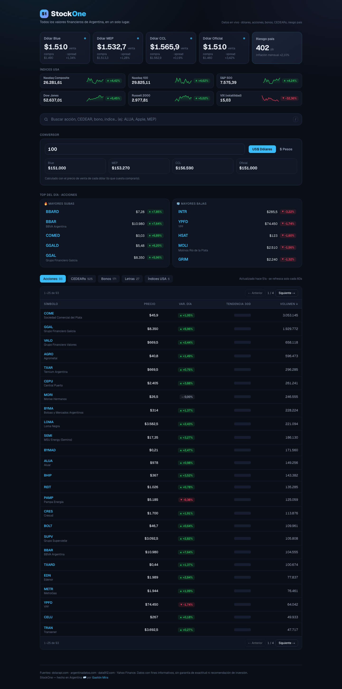
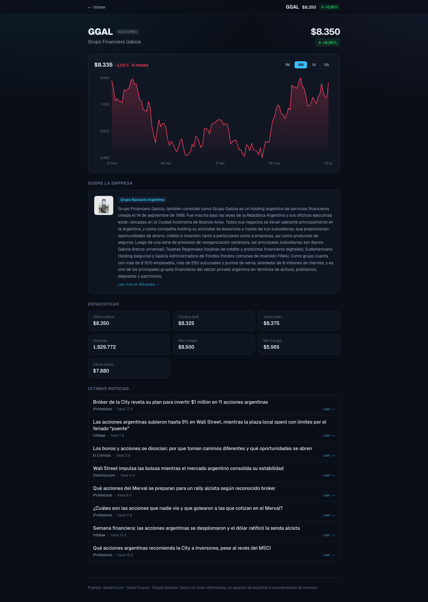

<div align="center">

# StockOne 📈🇦🇷

**Every financial value in Argentina, in one place.**

Dollars (blue · MEP · CCL · oficial), country risk, stocks, bonds, CEDEARs, letras and US indices — live, searchable, and free.

🔗 **[stockone-nu.vercel.app](https://stockone-nu.vercel.app)**



</div>

---

## 🧪 The experiment

This whole app was built **in a single sitting — during a World Cup match** (England vs Norway on the clock), as a challenge: ship a real, production web app before the final whistle.

Two reasons: to keep the pre-match nerves down before Argentina played, and to sharpen my AI skills by actually building *with* AI, using **[Claude Code](https://claude.com/claude-code)**.

The workflow was fully iterative: **ship → look at it → spot something wrong → fix → ship again**, minutes per loop. The MVP went live first, and every feature after that was its own small iteration.

## ✨ Features

- **Live dashboard** — dollar rates (blue, MEP, CCL, oficial), country risk & inflation, and US indices (Nasdaq, S&P 500, Dow…) with sparklines.
- **Global search** — find any stock, CEDEAR, bond, letra or index by symbol or name.
- **Currency converter** — USD ⇄ ARS across every dollar type, with live formatting.
- **Top movers** — biggest gainers and losers of the day.
- **Detail pages** (`/i/[category]/[symbol]`) — historical price chart with range selector (1M/6M/1Y/5Y), key stats, latest news in Spanish (last 30 days), and an auto-generated **company profile from Wikipedia**.
- **Sortable, paginated tables** (25 per page) per category.
- **SEO** — dynamic Open Graph / Twitter images, sitemap, robots, JSON-LD.



## 🗂️ Data sources (all free & public)

| What | Source |
| --- | --- |
| Dollar rates | [dolarapi.com](https://dolarapi.com) |
| Country risk & inflation | [argentinadatos.com](https://argentinadatos.com) |
| Stocks / CEDEARs / bonds / letras | [data912.com](https://data912.com) |
| Historical prices & US indices | Yahoo Finance |
| News | Google News RSS |
| Company profiles | Wikipedia (ES) |

No API keys, **no database** — just live data with smart ISR caching.

## 🧱 Tech stack

- **[Next.js](https://nextjs.org)** (App Router) + **TypeScript**
- **Tailwind CSS v4**
- **[Vercel](https://vercel.com)** — hosting + Web Analytics
- SVG charts hand-rolled (no chart library)

## 🏗️ How it works

- `lib/sources.ts` — typed fetchers for each source, normalized to a common `Instrument` model. Everything runs through `Promise.allSettled`, so one failing source never breaks the page.
- Server Components fetch on the server with `revalidate` (ISR) caching (60s for market data, longer for news/profiles) to stay fast and avoid hammering the APIs.
- `app/api/market` and `app/api/history` expose cached JSON for client-side refresh and the chart range selector.
- Detail pages are server-rendered per instrument and individually indexable.

## 🚀 Run it locally

```bash
npm install
npm run dev
# http://localhost:3000
```

Build:

```bash
npm run build && npm start
```

## ☁️ Deploy

Deployed on Vercel. Any push (or `vercel --prod`) ships it.

## ⚠️ Disclaimer

For informational purposes only. Data may be delayed or inaccurate and is **not** investment advice.

## 👤 Author

Built by **[Gastón Mira](https://www.gastonmira.dev)** with [Claude Code](https://claude.com/claude-code).
